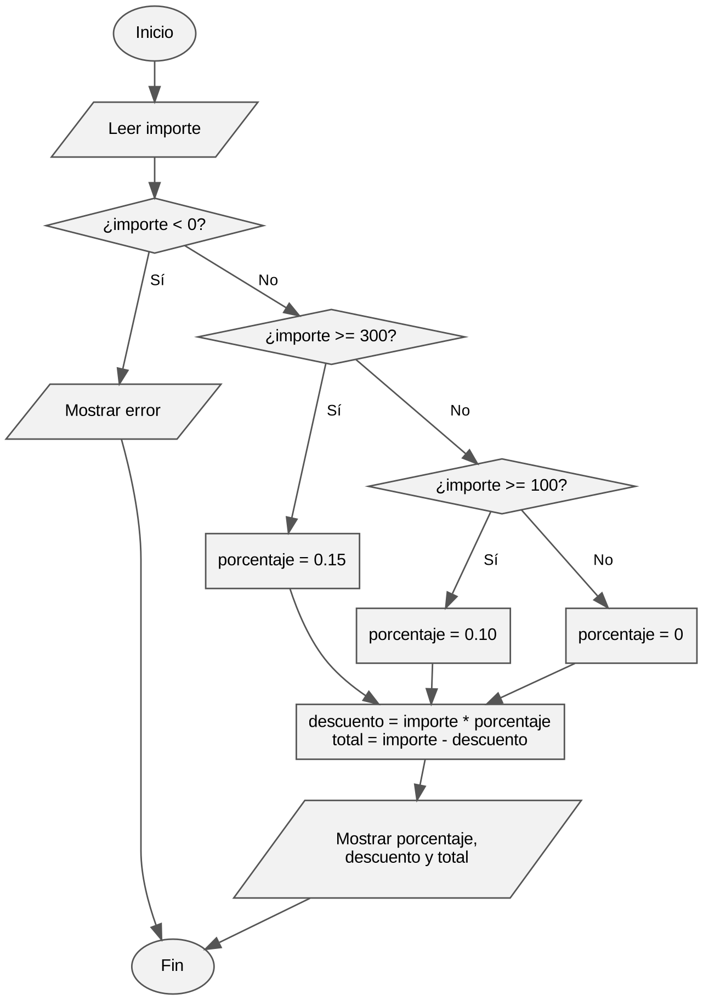

# Práctica D2. Del enunciado al programa

Módulo 0485 Programación · UD 2 · 1.º DAW · Curso 2026/2027
Autor: Diego Sánchez Azorín

## Enunciado

Una tienda aplica un descuento del 10 % a partir de 100 € de compra y del 15 % a partir de 300 €.

## 1. Análisis

| Tipo | Dato | Descripción |
|---|---|---|
| Entrada | importe | Lo que cuesta la compra en euros. Es un número decimal (float). |
| Salida | porcentaje | El descuento que se aplica: 0 %, 10 % o 15 %. |
| Salida | descuento | Los euros que se descuentan. |
| Salida | total | Lo que hay que pagar después del descuento. |

Restricciones. El importe no puede ser negativo, y si lo es el programa muestra un error. Por debajo de 100 € no hay descuento. Desde 100 € justos hasta justo antes de 300 € se descuenta un 10 %. Desde 300 € justos se descuenta un 15 %. Los dos límites, 100 y 300, ya tienen descuento, porque el enunciado dice "a partir de". Los importes se muestran con dos decimales.

## 2. Diseño

### Pseudocódigo

```
Algoritmo DescuentoTienda
    Leer importe
    Si importe < 0 Entonces
        Escribir "Error: el importe no puede ser negativo"
    SiNo
        Si importe >= 300 Entonces
            porcentaje <- 0.15
        SiNo
            Si importe >= 100 Entonces
                porcentaje <- 0.10
            SiNo
                porcentaje <- 0
            FinSi
        FinSi
        descuento <- importe * porcentaje
        total <- importe - descuento
        Escribir porcentaje, descuento, total
    FinSi
FinAlgoritmo
```

Primero se comprueba si llega a 300 y después si llega a 100. Si se hiciera al revés, una compra de 500 € entraría en el 10 % y no llegaría a comprobar el 15 %.

### Diagrama de flujo



## 3. Codificación

El programa está en [tienda.py](tienda.py) y sigue la estructura completa del apartado 5.6: docstring de cabecera, constantes, una función documentada que calcula el porcentaje, la función `main()` y el bloque `if __name__ == "__main__"`.

Para ejecutarlo:

```
python tienda.py
```

## 4. Pruebas

| N.º | Importe (€) | Resultado esperado | Resultado obtenido | ¿Correcto? |
|---|---|---|---|---|
| 1 | 50 | 0 %, descuento 0.00, total 50.00 | 0 %, descuento 0.00, total 50.00 | Sí |
| 2 | 99.99 | 0 %, descuento 0.00, total 99.99 | 0 %, descuento 0.00, total 99.99 | Sí |
| 3 | 100 | 10 %, descuento 10.00, total 90.00 | 10 %, descuento 10.00, total 90.00 | Sí |
| 4 | 150 | 10 %, descuento 15.00, total 135.00 | 10 %, descuento 15.00, total 135.00 | Sí |
| 5 | 299 | 10 %, descuento 29.90, total 269.10 | 10 %, descuento 29.90, total 269.10 | Sí |
| 6 | 300 | 15 %, descuento 45.00, total 255.00 | 15 %, descuento 45.00, total 255.00 | Sí |
| 7 | 500 | 15 %, descuento 75.00, total 425.00 | 15 %, descuento 75.00, total 425.00 | Sí |
| 8 | -20 | Mensaje de error | Error: el importe no puede ser negativo. | Sí |

Los casos 2, 3 y 6 son los límites que pide el enunciado, que es donde más fácil es equivocarse. Con 99.99 € todavía no hay descuento y con 100 € justos ya sí. Con 299 € se sigue aplicando el 10 %, y con 300 € justos ya pasa al 15 %.

## 5. Documentación

El programa tiene un docstring de cabecera que explica qué hace, el autor y la fecha, y la función `calcular_porcentaje` tiene su propio docstring. Los bloques de entrada, proceso y salida están comentados. Sigue la PEP 8: nombres de variables y funciones en minúsculas con guion bajo, constantes en mayúsculas, sangría de 4 espacios, espacios alrededor de los operadores y dos líneas en blanco entre funciones. Los umbrales y los porcentajes están en constantes, así que si la tienda los cambia solo hay que tocarlos en un sitio.
